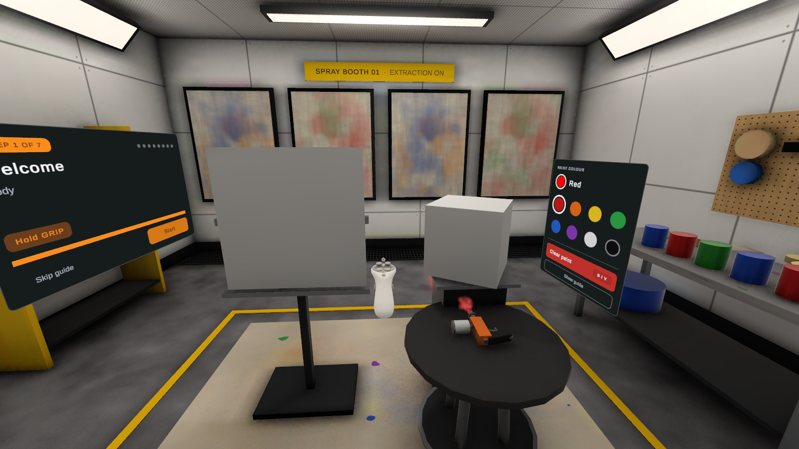
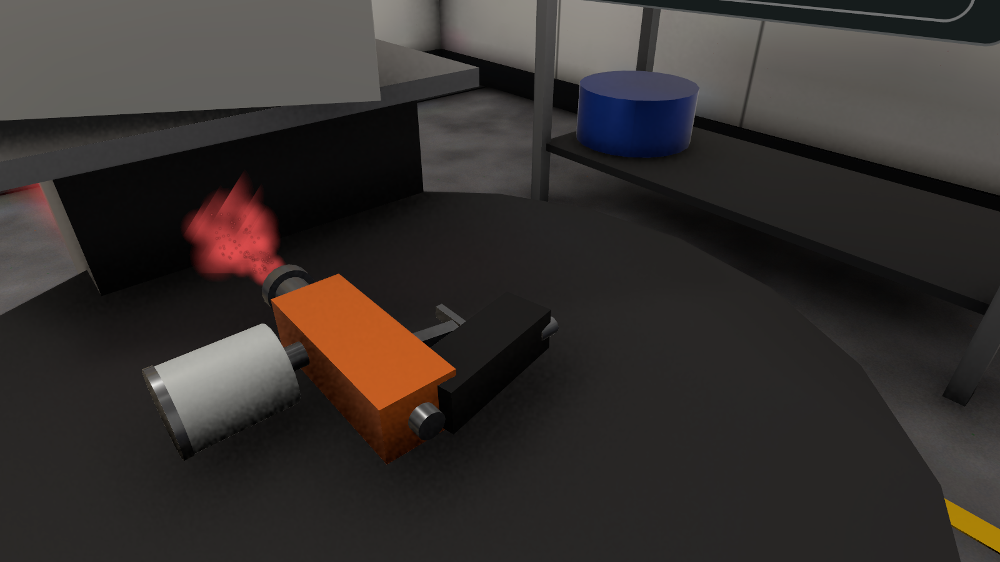
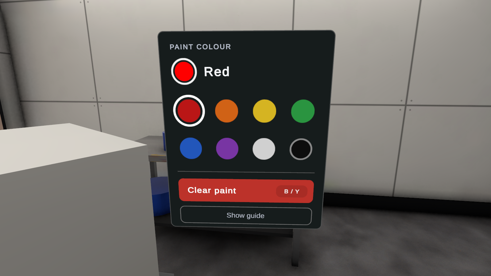
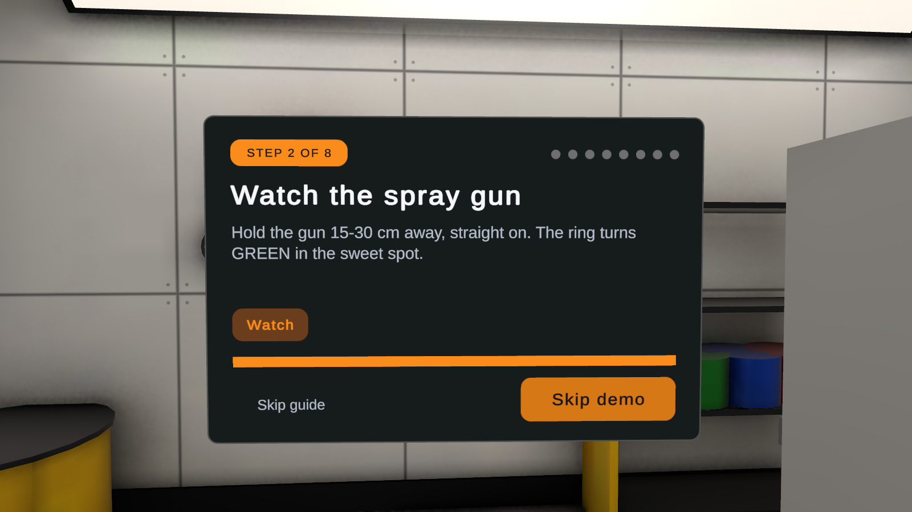
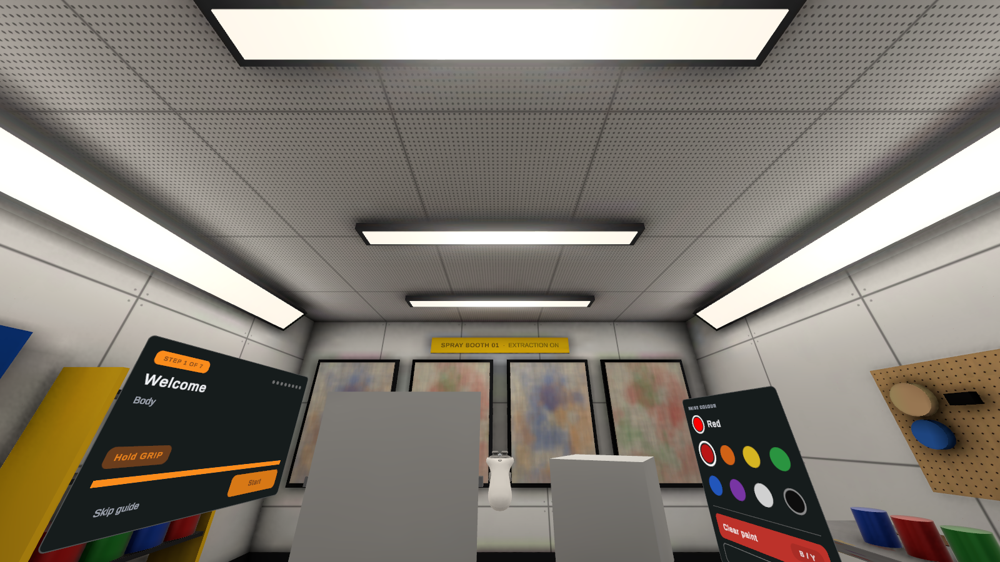

# VR Spray Painting

A realistic spray-painting prototype for Meta Quest 2 / Quest 3, built with Unity 6, URP and OpenXR.
Pick up a spray gun, find the right distance, and lay down paint that builds up, blends and covers like real paint.



| Spray gun | Paint palette |
|---|---|
|  |  |
| **Guided onboarding** | **Baked fixture lighting** |
|  |  |

## Features

### Spray gun
- **Real spray cone.** The spot grows with distance (distance × tan(cone/2)). Tilting the gun stretches it into an ellipse.
- **Distance zones**, shown by a ring on the surface:

  | Ring | Distance | Result |
  |---|---|---|
  | Orange | under 15 cm | wet, heavy |
  | Green | 15–30 cm | sweet spot |
  | Yellow | 30–45 cm | dry, speckled |
  | Red | over 45 cm | no paint |

- **Close range.** The gun still paints very close to the surface. It stops only when the nozzle clips into it.
- **Adjustable cone.** Thumbstick up gives a tighter spray, down a wider one (8°–35°).
- **Feedback.** VFX Graph droplets and mist, spray sounds (valve, hiss, choke-off) and controller haptics.

### Paint simulation
- **Paint texture.** A half-float texture per surface stores colour plus paint volume (coats).
- **Natural colour blending.** Uses Kubelka–Munk film-over-background mixing:
  - A thin new coat tints the colour underneath.
  - A heavy coat covers it.
  - Sparse overspray stays as separate dots.
- **Fast coverage.** One pass covers most of the surface, like real spray paint. The result doesn't depend on frame rate.
- **Performance.** Each stamp only redraws its own small rectangle of the texture, which keeps it cheap on Quest.

### Onboarding
- **Intro demo.** The real spray gun flies over and paints the panel by itself. It shows the sweet spot, too close, too far and colour blending, then returns to the stool.
- **Step-by-step guide.** Each step completes when you actually do it: grab, spray, build up a coat, change colour, reset.
- **Floating hints** point at the gun, the panel and the palette.

### Environment
- **Paint booth** with baked area lighting from the light fixtures, light probes and one realtime shadow-casting light.
- **Palette** to pick colours and clear the paint.
- **Gun return.** A dropped gun returns to its stool by itself.

## Controls (Quest)

| Action | Input |
|---|---|
| Pick up gun | Grip |
| Spray | Trigger |
| Tighter / wider spray | Thumbstick up / down |
| Press UI buttons | Point + Trigger |
| Clear all paint | B / Y (R on keyboard) |

## Requirements

- Unity **6000.3.23f1**
- URP 17.3, OpenXR 1.16, XR Interaction Toolkit 3.3.2, XR Hands 1.7, Input System 1.20, VFX Graph 17.3
- Meta Quest 2 or Quest 3 (Android build target)

## Getting started

1. Clone the repo.
2. **Import the paid plugins.** These Asset Store packages are not in the repo because their licence doesn't allow redistribution. Import them into `Assets/ExternalFramework/` before opening the project, or the shared framework won't compile:
   - **Best HTTP (Pro)** → `Assets/ExternalFramework/Best HTTP (Pro)/`
   - **EnhancedScroller** → `Assets/ExternalFramework/EnhancedScroller/`
3. Open the project in Unity 6000.3.23f1.
4. Open `Assets/VRSprayPainting/Scenes/PaintTest.unity`.
5. To run on device, switch to Android in Build Profiles, then Build & Run with the Quest connected.
6. To run in the editor, use Quest Link / Air Link with Play Mode.

### Editor tools

`Tools > VR Spray Painting`:

| Menu item | What it does |
|---|---|
| Run All / 1–3 | Installs the XR packages, sets Quest player settings and creates a minimal paint test scene |
| Build Environment | Rebuilds the paint booth (also re-bakes lighting) |
| Build Lighting (bake) | Fixture lights, light probes and lightmap bake. Re-run after moving scene geometry |
| Build Paintable Cube Mesh | Cube with a separate UV area per face, so paint doesn't show on every side |
| Build Spray VFX | Regenerates the droplet and mist VFX graphs |

## Project structure

```
Assets/VRSprayPainting/
├── Editor/         Builders for the scene, lighting, meshes and VFX
├── Scenes/         PaintTest scene + lighting settings
├── Scripts/
│   ├── Constants/  Shader IDs, data-binding / observer keys
│   ├── Controllers/SprayGun, SprayGunAudio, SprayAimMarker, SprayDemoController,
│   │               OnboardingController, PaintResetInput, ReturnHome
│   ├── Interfaces/ IPaintable
│   ├── Models/     Painting (SprayPainter, PaintableSurface, PaintStamp), Onboarding data
│   ├── UI/         Onboarding and palette screens, swatch buttons
│   └── Utils/      HintBob
├── Shaders/        PaintStamp (paint deposit + KM mixing), PaintedSurface (URP lit + lightmaps)
├── Sounds/         Spray loop, start, stop, trigger click
└── VFX/            Spray droplet and mist graphs
```

`Assets/ExternalFramework/` contains a shared framework (service locator, data binding, UI system). Don't change it from this project.

## How painting works

1. **Aim.** `SprayPainter` raycasts from the nozzle and converts the cone footprint into an elliptical stamp in the surface's UV space, using the hit triangle.
2. **Stamp size.** The amount of paint scales with spot area and distance, and stamps are spaced along fast strokes.
3. **Deposit.** `PaintableSurface` draws the stamp with `PaintStamp.shader` into a scratch texture, only inside the stamp's rectangle, then copies it back.
4. **Display.** `PaintedSurface.shader` shows coverage as `1 - exp(-volume)` over the primer, with URP lighting.
